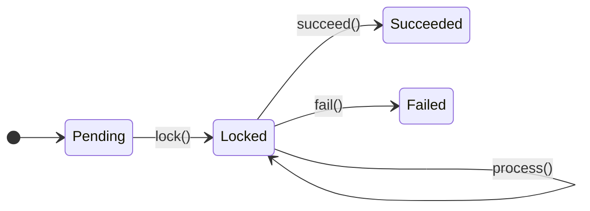
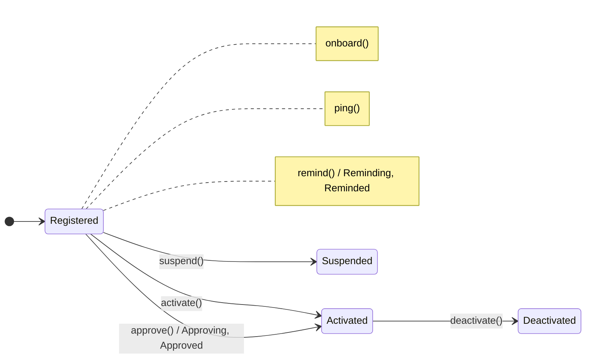

# Eloquent State Machine
This package provides a State Pattern system for Eloquent.

## Installation
```bash
composer require aryeo/eloquent-state-machines
```

## Overview
State Machine is a simple implementation of the State Pattern comprised of three parts:
- States: Discrete modes a `Model` can be in.
- Transitions: Available movement between states.
- Triggers: Work performed to complete a transition.

## Usage
### Define States
States are defined and configured through a Backed Enum.

```php
namespace Users\Status;

use Support\Database\Eloquent\StateMachines\Contracts\StateMachineable;
use Support\Database\Eloquent\StateMachines\Provides\ManagesState;

enum Status: string implements StateMachineable
{
    use ManagesState;

    case Registered = 'registered';
    case Activated = 'activated';
    case Suspended = 'suspended';
}
```

### Associate Events

#### 1. Create Events
```php
namespace Users\Status\Events\States;

use Users\User;

class Activating
{
    public readonly User $model;

    public function __construct(User $model)
    {
        $this->model = $model;
    }
}
```

```php
namespace Users\Status\Events\States;

use Users\User;

class Activated
{
    public readonly User $model;

    public function __construct(User $model)
    {
        $this->model = $model;
    }
}
```

#### 2. Register events

> Note: Every case must have an `#[Events]` attribute. If one is missing, a `\Support\Database\Eloquent\StateMachines\Attributes\Events\Exceptions\NotDefined` exception will be thrown.

```php
namespace Users\Status;

use Support\Database\Eloquent\StateMachines\Attributes\Events\Events;
use Support\Database\Eloquent\StateMachines\Contracts\StateMachineable;
use Support\Database\Eloquent\StateMachines\Provides\ManagesState;

enum Status: string implements StateMachineable
{
    use ManagesState;
    // ...

    #[Events(before: Activating::class, after: Activated::class)]
    case Activated = 'activated';

    // ..
}
```

> **Note:** The `after` event never runs inside the transaction — it fires only after the transition has committed. A throwing listener therefore cannot roll the transition back.

> **Note:** Only a trigger dispatches events. Creating a model in its initial state, such as a `User` whose `status` defaults to `Registered`, dispatches neither event of that state's pair.

#### 3. Lay out events

Place a state machine's events beside it, with one namespace for state events and one for transition events (see [Transition Events](#transition-events)). `<Machine>` is the state machine's directory:

```
<Entity>/<Machine>/Events/States/<Event>.php
<Entity>/<Machine>/Events/Transitions/<Event>.php
```

```
Users/Status/Events/States/Activating.php
Users/Status/Events/States/Activated.php
Users/Status/Events/Transitions/Reinstating.php
Users/Status/Events/Transitions/Reinstated.php
```

A state event and a transition event may share a basename, such as `States\Activated` and `Transitions\Activated`. Only the namespace separates them. The package does not enforce this layout.

### Define Transitions
Transitions are represented by the target state and the trigger used to complete the operation.

#### 1. Create a Trigger
```php
namespace Users\Status\Triggers;

use Support\Database\Eloquent\StateMachines\Triggers\Target\Target;
use Support\Database\Eloquent\StateMachines\Triggers\Trigger;
use Users\User;

class Suspend extends Trigger
{
    #[Target]
    protected readonly User $user;

    public function allowed(): bool
    {
        return $this->user->is_not_trashed;
    }

    public function handle(): void
    {
        // business operations...
    }
}
```

> Note: The `#[Target]` attribute is required to specify which property contains the model being operated on.

A `Trigger` is a specialized [Action](https://github.com/AryeoHQ/actions) — it extends the `Action` contract and uses `AsAction` under the hood, so it can be run synchronously with `->now()` or dispatched to the queue with `->dispatch()`. On top of that, a `Trigger` adds state management, event dispatching, transition logic, and gate checks via `allowed()` and `blocked()`.

> **Note:** `SerializesModels` is left off the base `Trigger` so each trigger can opt in for itself. Without it (the default), a dispatched model is serialized as-is, so the worker sees the model exactly as it was at dispatch. Add `use \Illuminate\Queue\SerializesModels;` to a trigger when you want Laravel's default instead — storing only the model identifier and rehydrating fresh from the database when the job runs.

> **Note:** Even though a `Trigger` is an Action, it defines a `final prepare()` method to register lifecycle middleware (transaction boundaries, `before()`/`after()` hooks) that the state machine depends on. Use the `$middleware` property to add your own middleware, and the constructor or `handle()` method parameters for setup and dependency injection.

#### 2. Register Transition
```php
namespace Users\Status;

use Support\Database\Eloquent\StateMachines\Attributes\Events\Events;
use Support\Database\Eloquent\StateMachines\Attributes\Transitions\Transition;
use Support\Database\Eloquent\StateMachines\Contracts\StateMachineable;
use Support\Database\Eloquent\StateMachines\Provides\ManagesState;
use Users\Status\Triggers;

enum Status: string implements StateMachineable
{
    use ManagesState;

    // ...

    #[Events(before: Activating::class, after: Activated::class)]
    #[Transition(to: self::Suspended, using: Triggers\Suspend::class)]
    case Activated = 'activated';

    // ..
    case Suspended = 'suspended';
}
```

#### Transition Events

A trigger always dispatches the target state's `#[Events]`, so every transition into one state raises the same pair. A transition can also declare its own `before` and `after` events:

```php
#[Events(before: Suspending::class, after: Suspended::class)]
#[Transition(to: self::Activated, using: Triggers\Reinstate::class, before: Reinstating::class, after: Reinstated::class)]
case Suspended = 'suspended';
```

`reinstate()` raises both pairs, and the state's event comes first in each phase:

1. `Activating`, then `Reinstating`, inside the lifecycle transaction
2. `Activated`, then `Reinstated`, after the transaction commits

A transition into `Activated` that declares no events raises `Activating` and `Activated` only. A listener on `Activated` therefore hears every entry into the state, and a listener on `Reinstated` hears only a reinstatement. Each event receives the model, as a state's events do.

A transition declares both events or neither. A transition that declares one throws `Attributes\Events\Exceptions\Incomplete`, and an event class that does not exist throws `Attributes\Events\Exceptions\NotFound`. The state's `#[Events]` stays required on every case.

Each event class belongs to one declaration. When two states, two transitions, or a state and a transition declare one class, `events()` and `transitions()` throw `Attributes\Events\Exceptions\Reused` on every case of the enum. Every trigger reads both, so the first trigger to run throws.

#### Stationary Transitions

A transition can target the current state. This is useful when a state represents a holding pattern — the trigger executes guarded logic without moving the model to a new state.

```php
#[Events(before: Locking::class, after: Locked::class)]
#[Transition(to: self::Locked, using: Triggers\Process::class)]
#[Transition(to: self::Succeeded, using: Triggers\Succeed::class)]
#[Transition(to: self::Failed, using: Triggers\Fail::class)]
case Locked = 'locked';
```



When a trigger targets the current state:
- `allowed()` is still evaluated
- `handle()` executes normally
- The state's before and after events are dispatched, and so are the transition's own events when it declares them, in the order [Transition Events](#transition-events) describes
- The state column is **not** written

`process()` therefore raises `Locking` and `Locked` on every run. A trigger can also be built by hand with one state in both `from()` and `to()`. When that state declares no such transition, the trigger dispatches no events.

This lets you define named, guarded entry points for work within a state without introducing intermediate states into your graph.

#### Running a Trigger Without Its Transition

Some callers store the new state themselves before any trigger runs, for example through a database view. `withoutTransition()` runs the transition's trigger for that stored state and does not write the state column again.

```php
$user->status->activate()->withoutTransition()->now();

$user->status->activate()->withoutTransition()->dispatch();
```

The model must hold the source state in its attribute and in its raw original, as it was loaded before the caller's write. The persisted row must hold the target state. Call the trigger through the proxy of the column that changed, as [Configure Model](#configure-model) describes.

A trigger whose model is reloaded from the database after the caller's write therefore refuses. A `SerializesModels` trigger reloads its model when the job runs, so the model already holds the target state and fails the source-state check.

Everything else runs as it does for an ordinary transition:
- the source-state check
- `allowed()`
- the before and after events
- `handle()`, with the constructor arguments passed to the trigger method, such as `$user->status->suspend($at)->withoutTransition()`
- the lifecycle transaction, the refresh after a rollback, and `failed()`

The locked re-read of the persisted row still runs, but it confirms that the row holds the target state. On an ordinary run the re-read stops a second run, because the first run moves the row off the source state. Here the row holds the target state before and after the run. A retried or duplicated run therefore passes the re-read again, and it repeats `handle()` and both events.

On a failure, the state stays where the caller wrote it, and after a transactional rollback `failed()` sees the target state.

At the trigger's declared phase, the state attribute takes the target state and is marked as unchanged. `handle()` and both event listeners therefore see what they see on an ordinary run. The `save()` after `handle()` writes only what `handle()` changed. When `handle()` leaves nothing unsaved, the trigger skips that `save()`, so a `saved` listener runs once for `handle()`'s own save. `now()` returns the model, which holds the target state with no unsaved state change.

Inside a caller's transaction on the model's connection, the lifecycle transaction becomes a savepoint. A refusal, or an exception from `handle()`, is thrown inside the caller's transaction, so the caller can still roll back its own write. What `handle()` changed commits with the caller's transaction. The after event fires when the caller's transaction commits.

The trigger refuses with `Attributes\Transitions\Exceptions\Invalid` when:
- the raw original does not hold the trigger's source state
- the persisted row does not hold the trigger's target state, which includes a trigger that leads to a different state
- the model is unsaved, because it has no persisted row
- `allowed()` returns `false`

When several transitions lead from one state to another, choose the trigger by its method name. The proxy refuses a name that the current state does not declare with `Triggers\Exceptions\Invalid`. `Status::Registered->transitions()` lists a state's transitions, each with its `to` state and its `using` trigger, and needs no database.

A package that treats this one as optional checks for support with `method_exists(Trigger::class, 'withoutTransition')`.

#### Failures
When a particular `Trigger` fails the state machine will not be moved to the target state. However, you may want to alert your users or revert any actions that were partially completed by the trigger. To accomplish that, you may define a `failed` method on your `Trigger`. The `Throwable` instance that caused `handle()` to fail will be passed to `failed()`.

```php
namespace Users\Status\Triggers;

use Support\Database\Eloquent\StateMachines\Triggers\Target\Target;
use Support\Database\Eloquent\StateMachines\Triggers\Trigger;
use Throwable;
use Users\User;

class Upload extends Trigger
{
    #[Target]
    public readonly User $user;

    public function handle(): void
    {
        // business operations that may throw an exception...
    }

    public function failed(Throwable $throwable): void
    {
        $this->user->status->suspend()->now();
    }
}
```

When the lifecycle transaction rolls back (a thrown exception, or a manual `fail()` outside the queue), the model is refreshed before `failed()` runs, so `failed()` sees the database's truth — not in-memory state left over from the rolled-back `handle()` work. On a queue worker a manual `fail()` commits the transaction rather than rolling it back, so no refresh occurs (see below).

A `saving`, `creating` or `updating` listener that returns `false` cancels a `save()`. The trigger checks two of them: the save that writes the state column at the trigger's phase, and the save after `handle()`. When either one is cancelled while it has changes to write, or leaves changes unsaved, the trigger throws `Triggers\Exceptions\NotSaved`, which names the trigger, the model, its key and the state column. A cancelled `Phase::Before` save throws before `handle()` runs. The lifecycle transaction rolls back, the model is refreshed, `failed()` runs, and the after event does not fire.

#### Manually Failing a Trigger

Because a `Trigger` is an [Action](https://github.com/AryeoHQ/actions), it can mark itself as failed by calling `$this->fail()` — see [Manually Failing an Action](https://github.com/AryeoHQ/actions#manually-failing-an-action) for the contract (exceptions, per-path behavior, the fail-then-`return` convention).

What the state machine adds on top:

- The declared transition never lands and no after-event fires — the model ends wherever `failed()` routed it. The same applies to `$this->release()` on a queued run.
- **On a queue worker**, `failed()` routes the model *inside* the open lifecycle transaction — `handle()`'s work and the failure routing commit together, atomically.
- **Outside the queue** (`now()`, `dispatchSync()`), the lifecycle transaction rolls back (discarding `handle()`'s work) before `failed()` routes the model against fresh database state.

#### Opting Out of the Lifecycle Transaction

By default `before()` → `handle()` runs inside a transaction on the model's connection, so a thrown exception (or a `fail()` outside the queue) rolls back everything the trigger wrote — all-or-nothing state transitions are the core guarantee of the package.

Some triggers, though, do work the database can't take back: an HTTP call, publishing a message, sending an email. For those the transaction's guarantee doesn't fully apply — the side effect lands in the real world even when the surrounding writes roll back. Such a trigger may deliberately want its writes (audit rows, status stamps) to commit as they happen, so each run leaves a durable record alongside the side effect it performed.

Apply the `#[WithoutTransaction]` attribute to opt a trigger out of the transaction:

```php
namespace Users\Status\Triggers;

use Support\Database\Eloquent\StateMachines\Triggers\Target\Target;
use Support\Database\Eloquent\StateMachines\Triggers\Trigger;
use Support\Database\Eloquent\StateMachines\Triggers\WithoutTransaction;
use Users\User;

#[WithoutTransaction]
class Send extends Trigger
{
    #[Target]
    public readonly User $user;

    public function handle(): void
    {
        // side effects a rollback can't reach...
    }
}
```

When present, `lifecycle()` runs `before()` → `handle()` without opening a transaction. Everything else is unchanged: phase transitions, events, and `failed()` semantics all behave as before.

Keep the following in mind when opting out:

- **Writes are not rolled back.** If `handle()` throws (or calls `fail()`), whatever it already wrote stays committed. Because there is nothing to roll back, the model is **not** refreshed before `failed()` runs — `failed()` sees the in-memory state `handle()` left behind.
- **A cancelled save keeps `handle()`'s writes.** When a listener cancels the `save()` after `handle()`, the trigger still throws `Triggers\Exceptions\NotSaved` and the after event does not fire. What `handle()` already wrote stays committed.
- **A `Phase::Before` trigger stays transitioned on failure.** When the transition is written in `before()` (via `#[TransitionDuring(Phase::Before)]`), a later throw in `handle()` leaves the model in the new state, since there is no rollback. The default `Phase::After` transition never lands on a throw because `after()` is never reached.
- **The attribute is inheritable.** Resolution walks `class_parents`, mirroring `#[TransitionDuring(...)]`.
- **Nested transactions still apply.** A `#[WithoutTransaction]` trigger invoked inside another open transaction cannot escape it — its writes are only as durable as the outermost commit.

### Testing

A `Trigger` is an [Action](https://github.com/AryeoHQ/actions) — test it the same way. Focus on your business logic: `handle()`, `allowed()`, and `failed()`. The lifecycle plumbing (events, transitions, queue middleware) is handled by the package.

#### Testing handle()

Call `->now()` to execute the trigger synchronously and assert the side effects of your business logic.

```php
$user = User::factory()->registered()->create();

$user->status->activate()->now();

$this->assertNotNull($user->activated_at);
```

#### Testing allowed()

```php
$trigger = $user->status->suspend();

$this->assertTrue($trigger->allowed());
$this->assertFalse($trigger->blocked());
```

#### Testing failed()

If your trigger defines a `failed()` method, test it by triggering a failure through `->now()`:

```php
$user = User::factory()->registered()->create();

rescue(fn () => $user->status->upload()->now());

$this->assertEquals(Status::Suspended, $user->refresh()->status->enum);
```

#### Asserting a trigger was dispatched

When testing code that _dispatches_ a trigger (e.g., a controller or listener), use `::fake()` and `::assertFired()`:

```php
Activate::fake();

// ... code under test that dispatches Activate ...

Activate::assertFired();
```

> **Note:** `dispatch()` puts the trigger on the queue. You do not need to test `dispatch()` directly — the package tests the queue integration. Use `->now()` to test your trigger's behavior.

### Configure Model
```php
namespace Users;

use Users\Status\Status;

class User extends Model
{
    protected $attributes = [
        'status' => Status::Registered,
    ];

    protected function casts(): array
    {
        return [
            'status' => Status::class,
        ];
    }
}
```

A model may cast more than one column to the same enum. A trigger checks, re-reads and writes only the column its proxy was read from: `$user->status->activate()` moves `status`, and `$user->legacy_status->activate()` moves `legacy_status`.

A trigger refuses with `Attributes\Transitions\Exceptions\NotBound` when it has no column, or when its column is not cast to the trigger's enum. The refusal comes before the trigger reads the column, and the trigger changes nothing. A queued trigger whose payload holds no column, or a null column, therefore fails with `NotBound`. `NotBound` extends `Invalid`, so a `failed()` that returns early for `Invalid` also returns early for it. A `ShouldBeUnique` trigger releases its lock.

### Usage
Once your model is configured with a state machine enum, you can access the state machine through the casted property (e.g., `$user->status`). This gives you access to trigger methods that correspond to your defined transitions.

### Examples
```php
namespace Users\Actions;

use Users\User;

class Suspend
{
    public function handle(User $user)
    {
        return $user->status->suspend()->now();
    }
}
```

```php
namespace Users\Policies;

use Illuminate\Auth\Authenticatable;
use Users\User;

class User
{
    // ...

    public function suspend(Authenticatable $authenticated, User $user)
    {
        if ($user->status->suspend()->blocked()) return false;

        // ...
    }
}
```

## Tooling
This package provides configuration for tooling that assist with development efforts and enforce the expectations / requirements when using this package.

## Generator
Scaffold a new state machine enum with:

```bash
php artisan make:state-machine Status --model=App\\Models\\User
```

This creates a backed enum implementing `StateMachineable` with the `ManagesState` trait, along with a co-located test file. If `--model` is omitted, you will be prompted to select one.

## Diagramming
To keep your documentation updated a command is included to create Markdown Diagrams of the available State Machines:

<!-- diagram:Tests\Fixtures\Support\Users\Status\Status:start -->
**`Tests\Fixtures\Support\Users\Status\Status`**

<!-- diagram:Tests\Fixtures\Support\Users\Status\Status:end -->

A transition that declares its own events carries them in its label, after its trigger, as `remind()` and `approve()` show above.

### Usage
The command offers two primary outcomes.

1. Outputs the markdown for all of your `StateMachineables` to the terminal.
`php artisan state-machine:diagram`

    ```
    <!-- [starting-identifier] -->
    {{ MERMAID_MARKDOWN }}
    <!-- [ending-identifier]  -->
    ```


2. Automatically scans all of your project's markdown files for existing diagrams and updates them with the latest representation of a `StateMachineable` flow.
`php artisan state-machine:diagram --update`

    > ℹ️
    The comments in the example output above are required for the automatic scanning process to locate diagrams in project markdown files.
