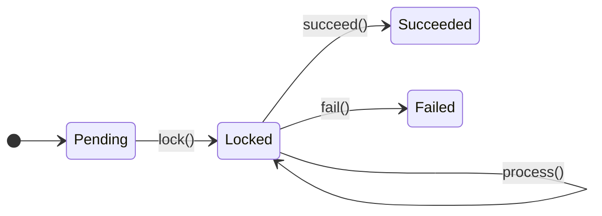
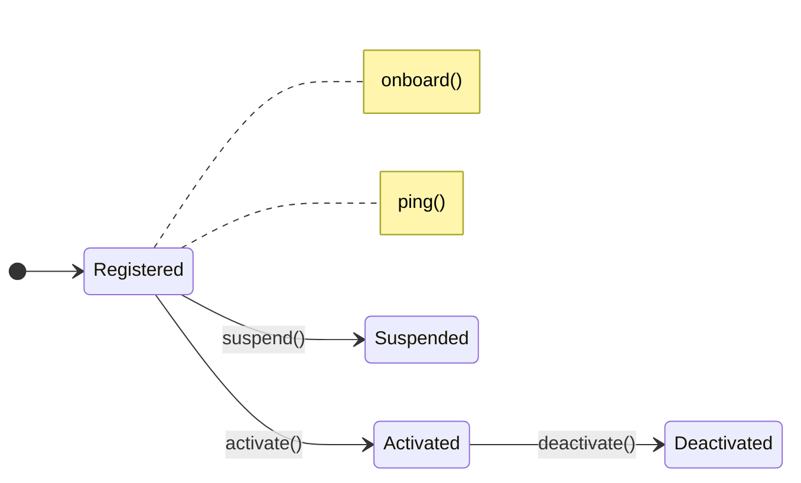

# Eloquent State Machine
This package provides a State Pattern system for Eloquent.

## Installation
```bash
composer require aryeo/eloquent-state-machines
```

## Overview
State Machine is a simple implementation of the State Pattern comprised of three parts:
- States: Discrete modes a `Model` can be in.
- Transitions: Available movement between states.
- Triggers: Work performed to complete a transition.

## Usage
### Define States
States are defined and configured through a Backed Enum.

```php
namespace Users\Status;

use Support\Database\Eloquent\StateMachines\Contracts\StateMachineable;
use Support\Database\Eloquent\StateMachines\Provides\ManagesState;

enum Status: string implements StateMachineable
{
    use ManagesState;

    case Registered = 'registered';
    case Activated = 'activated';
    case Suspended = 'suspended';
}
```

### Associate Events

#### 1. Create Events
```php
namespace Users\Status\Events;

use Users\User;

class Activating
{
    public readonly User $model;

    public function __construct(User $model)
    {
        $this->model = $model;
    }
}
```

```php
namespace Users\Status\Events;

use Users\User;

class Activated
{
    public readonly User $model;

    public function __construct(User $model)
    {
        $this->model = $model;
    }
}
```

#### 2. Register events

> Note: Every case must have an `#[Events]` attribute. If one is missing, a `\Support\Database\Eloquent\StateMachines\Attributes\Events\Exceptions\NotDefined` exception will be thrown.

```php
namespace Users\Status;

use Support\Database\Eloquent\StateMachines\Attributes\Events\Events;
use Support\Database\Eloquent\StateMachines\Contracts\StateMachineable;
use Support\Database\Eloquent\StateMachines\Provides\ManagesState;

enum Status: string implements StateMachineable
{
    use ManagesState;
    // ...

    #[Events(before: Activating::class, after: Activated::class)]
    case Activated = 'activated';

    // ..
}
```

> **Note:** The `after` event never runs inside the transaction — it fires only after the transition has committed. A throwing listener therefore cannot roll the transition back.

### Define Transitions
Transitions are represented by the target state and the trigger used to complete the operation.

#### 1. Create a Trigger
```php
namespace Users\Status\Triggers;

use Support\Database\Eloquent\StateMachines\Triggers\Target\Target;
use Support\Database\Eloquent\StateMachines\Triggers\Trigger;
use Users\User;

class Suspend extends Trigger
{
    #[Target]
    protected readonly User $user;

    public function allowed(): bool
    {
        return $this->user->is_not_trashed;
    }

    public function handle(): void
    {
        // business operations...
    }
}
```

> Note: The `#[Target]` attribute is required to specify which property contains the model being operated on.

A `Trigger` is a specialized [Action](https://github.com/AryeoHQ/actions) — it extends the `Action` contract and uses `AsAction` under the hood, so it can be run synchronously with `->now()` or dispatched to the queue with `->dispatch()`. On top of that, a `Trigger` adds state management, event dispatching, transition logic, and gate checks via `allowed()` and `blocked()`.

> **Note:** `SerializesModels` is left off the base `Trigger` so each trigger can opt in for itself. Without it (the default), a dispatched model is serialized as-is, so the worker sees the model exactly as it was at dispatch. Add `use \Illuminate\Queue\SerializesModels;` to a trigger when you want Laravel's default instead — storing only the model identifier and rehydrating fresh from the database when the job runs.

> **Note:** Even though a `Trigger` is an Action, it defines a `final prepare()` method to register lifecycle middleware (transaction boundaries, `before()`/`after()` hooks) that the state machine depends on. Use the `$middleware` property to add your own middleware, and the constructor or `handle()` method parameters for setup and dependency injection.

#### 2. Register Transition
```php
namespace Users\Status;

use Support\Database\Eloquent\StateMachines\Attributes\Events\Events;
use Support\Database\Eloquent\StateMachines\Attributes\Transitions\Transition;
use Support\Database\Eloquent\StateMachines\Contracts\StateMachineable;
use Support\Database\Eloquent\StateMachines\Provides\ManagesState;
use Users\Status\Triggers;

enum Status: string implements StateMachineable
{
    use ManagesState;

    // ...

    #[Events(before: Activating::class, after: Activated::class)]
    #[Transition(to: self::Suspended, using: Triggers\Suspend::class)]
    case Activated = 'activated';

    // ..
    case Suspended = 'suspended';
}
```

#### Stationary Transitions

A transition can target the current state. This is useful when a state represents a holding pattern — the trigger executes guarded logic without moving the model to a new state.

```php
#[Events(before: Locking::class, after: Locked::class)]
#[Transition(to: self::Locked, using: Triggers\Process::class)]
#[Transition(to: self::Succeeded, using: Triggers\Succeed::class)]
#[Transition(to: self::Failed, using: Triggers\Fail::class)]
case Locked = 'locked';
```



When a trigger targets the current state:
- `allowed()` is still evaluated
- `handle()` executes normally
- Before/after events are **not** dispatched
- The state column is **not** written

This lets you define named, guarded entry points for work within a state without introducing intermediate states into your graph.

#### Failures
When a particular `Trigger` fails the state machine will not be moved to the target state. However, you may want to alert your users or revert any actions that were partially completed by the trigger. To accomplish that, you may define a `failed` method on your `Trigger`. The `Throwable` instance that caused `handle()` to fail will be passed to `failed()`.

```php
namespace Users\Status\Triggers;

use Support\Database\Eloquent\StateMachines\Triggers\Target\Target;
use Support\Database\Eloquent\StateMachines\Triggers\Trigger;
use Throwable;
use Users\User;

class Upload extends Trigger
{
    #[Target]
    public readonly User $user;

    public function handle(): void
    {
        // business operations that may throw an exception...
    }

    public function failed(Throwable $throwable): void
    {
        $this->user->status->suspend()->now();
    }
}
```

When the lifecycle transaction rolls back (a thrown exception, or a manual `fail()` outside the queue), the model is refreshed before `failed()` runs, so `failed()` sees the database's truth — not in-memory state left over from the rolled-back `handle()` work. On a queue worker a manual `fail()` commits the transaction rather than rolling it back, so no refresh occurs (see below).

#### Manually Failing a Trigger

Because a `Trigger` is an [Action](https://github.com/AryeoHQ/actions), it can mark itself as failed by calling `$this->fail()` — see [Manually Failing an Action](https://github.com/AryeoHQ/actions#manually-failing-an-action) for the contract (exceptions, per-path behavior, the fail-then-`return` convention).

What the state machine adds on top:

- The declared transition never lands and no after-event fires — the model ends wherever `failed()` routed it. The same applies to `$this->release()` on a queued run.
- **On a queue worker**, `failed()` routes the model *inside* the open lifecycle transaction — `handle()`'s work and the failure routing commit together, atomically.
- **Outside the queue** (`now()`, `dispatchSync()`), the lifecycle transaction rolls back (discarding `handle()`'s work) before `failed()` routes the model against fresh database state.

#### Opting Out of the Lifecycle Transaction

By default `before()` → `handle()` runs inside a `DB::transaction()`, so a thrown exception (or a `fail()` outside the queue) rolls back everything the trigger wrote — all-or-nothing state transitions are the core guarantee of the package.

Some triggers, though, do work the database can't take back: an HTTP call, publishing a message, sending an email. For those the transaction's guarantee doesn't fully apply — the side effect lands in the real world even when the surrounding writes roll back. Such a trigger may deliberately want its writes (audit rows, status stamps) to commit as they happen, so each run leaves a durable record alongside the side effect it performed.

Apply the `#[WithoutTransaction]` attribute to opt a trigger out of the transaction:

```php
namespace Users\Status\Triggers;

use Support\Database\Eloquent\StateMachines\Triggers\Target\Target;
use Support\Database\Eloquent\StateMachines\Triggers\Trigger;
use Support\Database\Eloquent\StateMachines\Triggers\WithoutTransaction;
use Users\User;

#[WithoutTransaction]
class Send extends Trigger
{
    #[Target]
    public readonly User $user;

    public function handle(): void
    {
        // side effects a rollback can't reach...
    }
}
```

When present, `lifecycle()` runs `before()` → `handle()` without opening a transaction. Everything else is unchanged: phase transitions, events, and `failed()` semantics all behave as before.

Keep the following in mind when opting out:

- **Writes are not rolled back.** If `handle()` throws (or calls `fail()`), whatever it already wrote stays committed. Because there is nothing to roll back, the model is **not** refreshed before `failed()` runs — `failed()` sees the in-memory state `handle()` left behind.
- **A `Phase::Before` trigger stays transitioned on failure.** When the transition is written in `before()` (via `#[TransitionDuring(Phase::Before)]`), a later throw in `handle()` leaves the model in the new state, since there is no rollback. The default `Phase::After` transition never lands on a throw because `after()` is never reached.
- **The attribute is inheritable.** Resolution walks `class_parents`, mirroring `#[TransitionDuring(...)]`.
- **Nested transactions still apply.** A `#[WithoutTransaction]` trigger invoked inside another open transaction cannot escape it — its writes are only as durable as the outermost commit.

#### The State Guard

A state changes only through a trigger. The package listens to `updating` on every model. When an update changes a column cast to a `StateMachineable` enum, and no trigger is running for that model instance and column, the update throws `StateChangedOutsideTrigger`. That covers `save()`, `update()`, and the extra columns of `increment()` and `decrement()`.

```php
$user->forceFill(['status' => Status::Activated])->save(); // throws StateChangedOutsideTrigger

$user->status->activate()->now(); // writes the state
```

- **Inserts pass.** A new model may carry any state, so factories and `$attributes` defaults keep working.
- **Every trigger path passes.** That covers `now()`, `dispatch()`, a queue worker, `Phase::Before`, `#[WithoutTransaction]`, and a trigger nested inside another trigger's `handle()`.
- **The guard sees only updates that raise model events.** These bypass it:
  - `saveQuietly()` and `updateQuietly()`.
  - Any write inside `Model::withoutEvents()`.
  - A query builder update, through `Model::query()->update()` or `DB::table()`.
  - A save of a model whose `$dispatchesEvents['updating']` event has a listener that returns a non-empty value. Eloquent then skips the `eloquent.updating` event the guard listens to.
- **`Event::fake()` with no arguments disables the guard.** It fakes the `eloquent.updating` events too. Fake specific events instead, for example `Event::fake([Activated::class])`, to keep the guard active.
- **The guard is scoped to the instance.** Inside a trigger, a save of a *different* instance of the same row is still refused.

To change a state without a trigger, for a repair or a test fixture, lift the guard for one callback:

```php
use Support\Database\Eloquent\StateMachines\Guard\StateGuard;

StateGuard::withoutStateGuard(fn () => $user->forceFill(['status' => Status::Activated])->save());
```

The guard comes back when the callback returns or throws.

#### Replaying a Stored Transition

Another package may need to apply a transition whose new state it already set on the model. `Trigger::replay()` takes a model whose state column holds the target state and whose raw original holds the source state:

```php
use Illuminate\Support\Facades\DB;
use Support\Database\Eloquent\StateMachines\Triggers\Trigger;

DB::transaction(function () use ($id) {
    $user = User::query()->lockForUpdate()->findOrFail($id);

    $user->forceFill(['status' => Status::Activated]);

    $changes = Trigger::replay($user, 'status'); // ['activated_at' => '2026-10-24 12:00:00']
});
```

The replay resolves the trigger from the source case's `#[Transition(to:, using:)]` and runs it through the same pipeline as `now()`:

- The transition check compares the model's raw original against the source state. It skips the persisted-state check, which `now()` runs with `lockForUpdate()`, and takes no lock of its own.
- `allowed()` runs, the before event fires, and `handle()` runs.
- The replay makes no transition write: it does not store the state column, and it does not save the model. It returns the attributes `handle()` changed, without the state column, and the caller saves them. Attributes the caller changed before the replay are not in the return.
- `handle()` may still save the model or other models. A save of the model in `handle()` writes the target state the caller set.
- The after event fires after the outermost commit.
- The replay opens no transaction, so run it inside the caller's own transaction.

The caller must hold the row lock for the whole replay. Load the model with `lockForUpdate()`, as the example does, or update the row earlier in the same transaction. Without the lock, two concurrent replays of one transition both pass the transition check, and both run `handle()`.

The replay throws in these cases:

- `InvalidArgumentException` when the column does not cast to a state machine, or when it holds no case of that state machine.
- `Invalid` when the raw original holds no case of the state machine, for example on a model that was never saved.
- `Invalid` when no `#[Transition]` on the source case leads to the target state.
- `Duplicate` when more than one `#[Transition]` on the source case leads to the target state.
- `Invalid` when `allowed()` returns `false`. The replay then throws before the before event and `handle()`.

While a replay runs, the guard treats it as a running trigger for the given column.

A replay differs from `now()` in these ways:

- **The trigger takes no arguments.** The replay builds it with `make()`. An optional constructor argument takes its default. A required argument that the container cannot resolve makes the transition unreplayable: the replay throws before the before event and `handle()`.
- **The target state is already in the attribute.** `handle()`, the before event listeners and `failed()` see the target state in the state column. Only the raw original still holds the source state.
- **`failed()` runs after the replay ends.** The guard no longer treats the model as running, and the state column is still dirty. A save in `failed()` therefore throws `StateChangedOutsideTrigger`, which the dispatcher reports and does not rethrow. Any other write in `failed()` rolls back when the caller's transaction rolls back.

After a replay, the guard refuses an Eloquent save of the state column. To save the model or raise its model events, wrap that work in `StateGuard::running()`. It exempts only that model instance and column, while `withoutStateGuard()` lifts the guard for every model:

```php
StateGuard::running($user, 'status', fn () => $user->save());
```

### Testing

A `Trigger` is an [Action](https://github.com/AryeoHQ/actions) — test it the same way. Focus on your business logic: `handle()`, `allowed()`, and `failed()`. The lifecycle plumbing (events, transitions, queue middleware) is handled by the package.

#### Testing handle()

Call `->now()` to execute the trigger synchronously and assert the side effects of your business logic.

```php
$user = User::factory()->registered()->create();

$user->status->activate()->now();

$this->assertNotNull($user->activated_at);
```

#### Testing allowed()

```php
$trigger = $user->status->suspend();

$this->assertTrue($trigger->allowed());
$this->assertFalse($trigger->blocked());
```

#### Testing failed()

If your trigger defines a `failed()` method, test it by triggering a failure through `->now()`:

```php
$user = User::factory()->registered()->create();

rescue(fn () => $user->status->upload()->now());

$this->assertEquals(Status::Suspended, $user->refresh()->status->enum);
```

#### Asserting a trigger was dispatched

When testing code that _dispatches_ a trigger (e.g., a controller or listener), use `::fake()` and `::assertFired()`:

```php
Activate::fake();

// ... code under test that dispatches Activate ...

Activate::assertFired();
```

> **Note:** `dispatch()` puts the trigger on the queue. You do not need to test `dispatch()` directly — the package tests the queue integration. Use `->now()` to test your trigger's behavior.

### Configure Model
```php
namespace Users;

use Users\Status\Status;

class User extends Model
{
    protected $attributes = [
        'status' => Status::Registered,
    ];

    protected function casts(): array
    {
        return [
            'status' => Status::class,
        ];
    }
}
```

### Usage
Once your model is configured with a state machine enum, you can access the state machine through the casted property (e.g., `$user->status`). This gives you access to trigger methods that correspond to your defined transitions.

### Examples
```php
namespace Users\Actions;

use Users\User;

class Suspend
{
    public function handle(User $user)
    {
        return $user->status->suspend()->now();
    }
}
```

```php
namespace Users\Policies;

use Illuminate\Auth\Authenticatable;
use Users\User;

class User
{
    // ...

    public function suspend(Authenticatable $authenticated, User $user)
    {
        if ($user->status->suspend()->blocked()) return false;

        // ...
    }
}
```

## Tooling
This package provides configuration for tooling that assist with development efforts and enforce the expectations / requirements when using this package.

## Generator
Scaffold a new state machine enum with:

```bash
php artisan make:state-machine Status --model=App\\Models\\User
```

This creates a backed enum implementing `StateMachineable` with the `ManagesState` trait, along with a co-located test file. If `--model` is omitted, you will be prompted to select one.

## Diagramming
To keep your documentation updated a command is included to create Markdown Diagrams of the available State Machines:

<!-- diagram:Tests\Fixtures\Support\Users\Status\Status:start -->
**`Tests\Fixtures\Support\Users\Status\Status`**

<!-- diagram:Tests\Fixtures\Support\Users\Status\Status:end -->

### Usage
The command offers two primary outcomes.

1. Outputs the markdown for all of your `StateMachineables` to the terminal.
`php artisan state-machine:diagram`

    ```
    <!-- [starting-identifier] -->
    {{ MERMAID_MARKDOWN }}
    <!-- [ending-identifier]  -->
    ```


2. Automatically scans all of your project's markdown files for existing diagrams and updates them with the latest representation of a `StateMachineable` flow.
`php artisan state-machine:diagram --update`

    > ℹ️
    The comments in the example output above are required for the automatic scanning process to locate diagrams in project markdown files.
